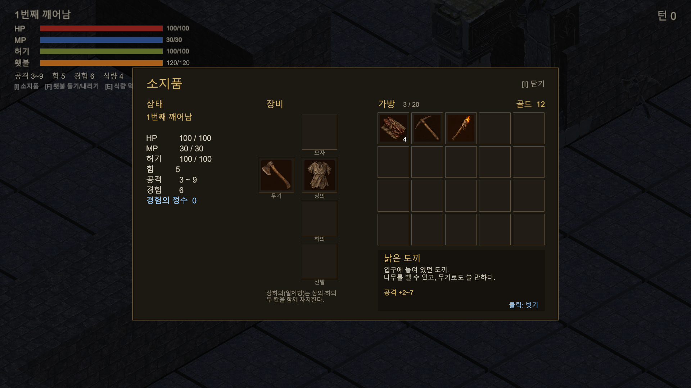
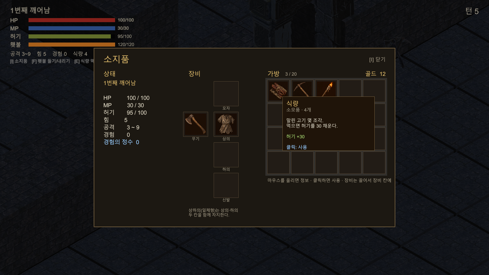
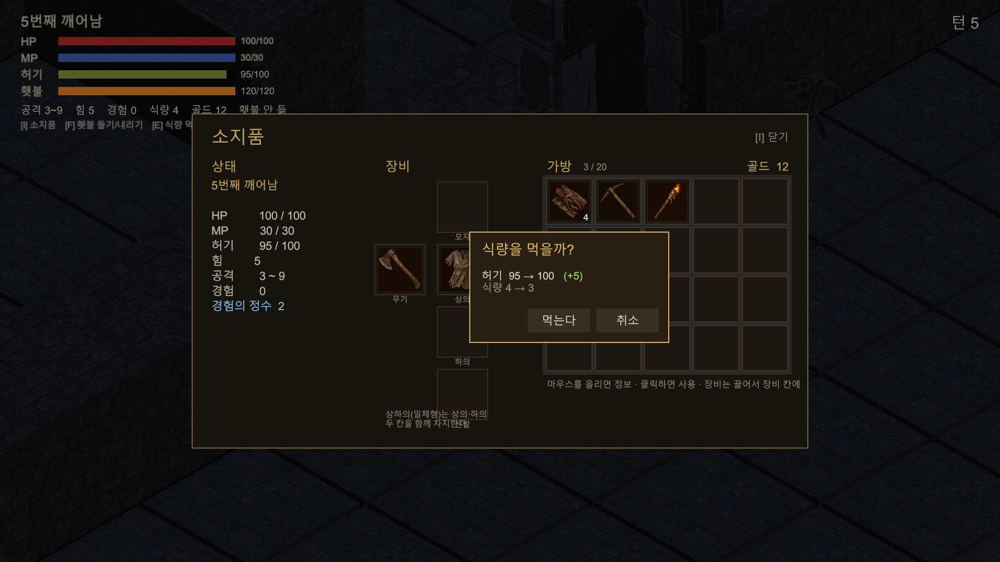
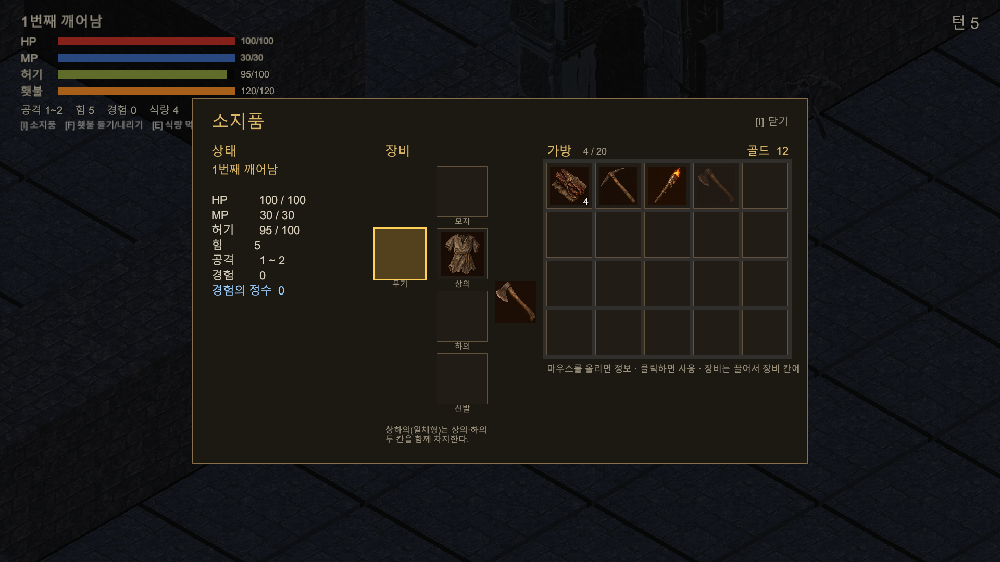
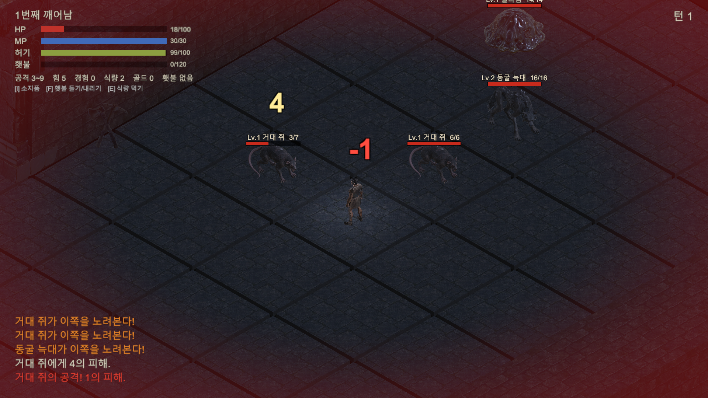
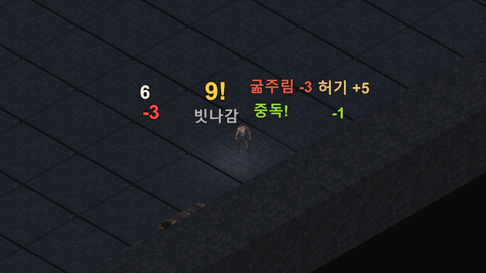
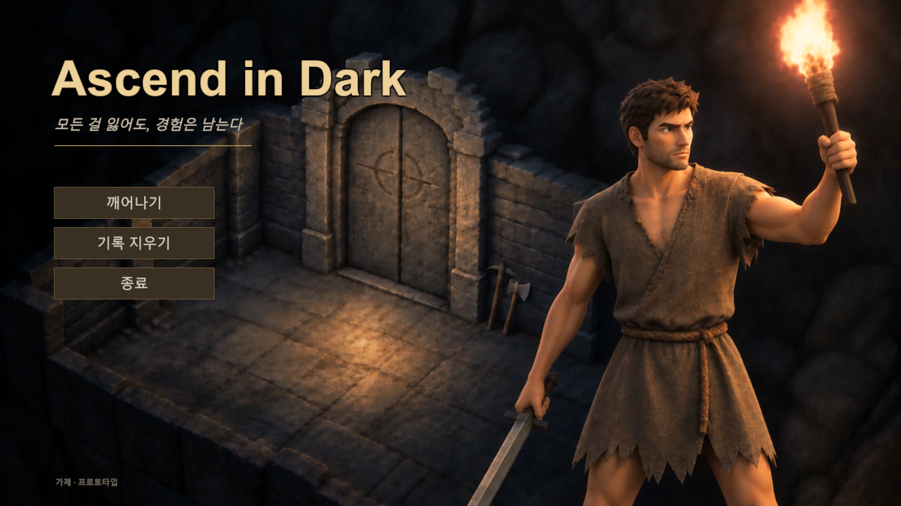
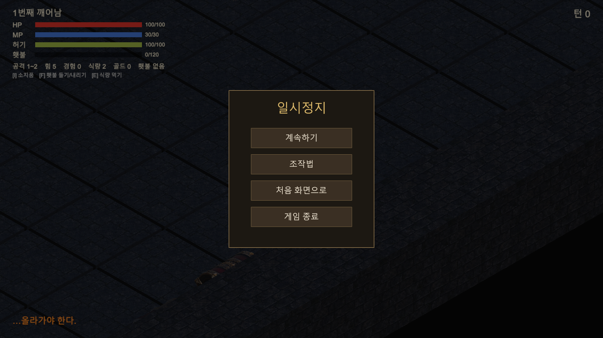
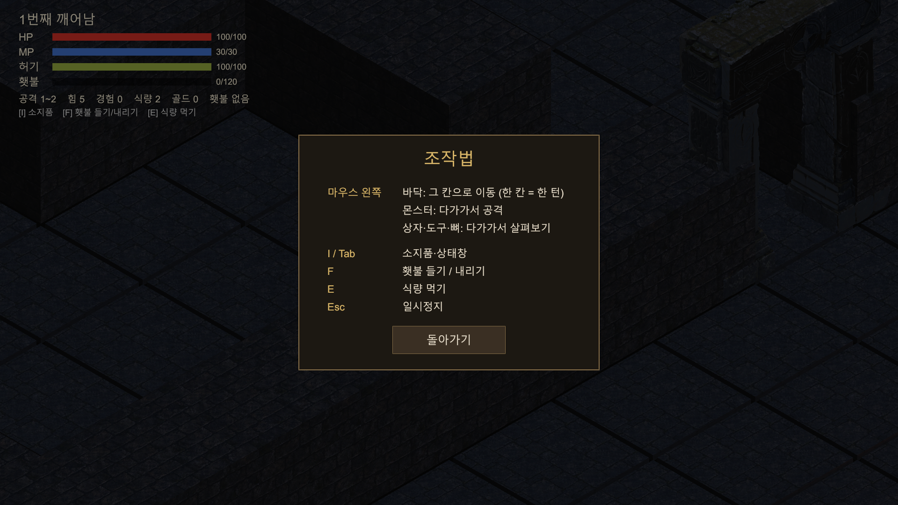
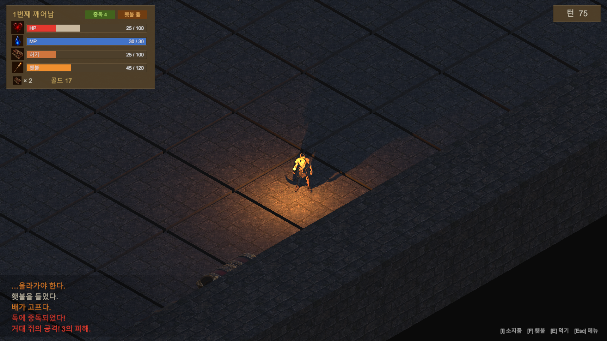

# 5강 2차시 선택 심화 미션 — 내 게임에 UI 적용하기

게임: 턴제 생존 로그라이크 RPG (가제 *Ascend in Dark*)
만든 UI: 4가지 — 상태창·소지품 / 데미지 숫자·피격 연출 / 타이틀·일시정지 메뉴 / HUD 개선
도구: Claude Code + Unity MCP (코드·씬 연결·플레이 확인), VARCO (아이콘·타이틀 배경)

---

## 1. 상태창·소지품 ([I] 또는 Tab)

**필요성** — 생존·제작이 핵심이라 "무엇을 들고, 무엇을 입었는지"를 확인할 창이 꼭 필요하다. 앞으로 만들 채집·제작도 이 가방을 그대로 쓴다.

**구현**
- 왼쪽: 깨어난 횟수, HP·MP·허기, 힘, 공격 범위, 경험, 경험의 정수
- 가운데: 장비 칸(모자·무기·상의·하의·신발)을 사람 모양으로 배치. 설정대로 상하의(일체형)는 상의·하의 두 칸을 차지
- 오른쪽: 가방 20칸 + 골드
- 아이템 아이콘 5종은 VARCO로 제작 (식량, 낡은 횃불, 낡은 도끼, 낡은 곡괭이, 누더기 튜닉)

**연결 (게임 상태·행동에 반응)**
- 마우스를 올리면 마우스 옆에 정보(종류·설명·효과)
- 식량·횃불 클릭 → 사용 확인 창에 효과 미리보기 (예: `허기 95 → 100 (+5)`)
- 장비 클릭(또는 끌기) → 아이콘이 마우스를 따라오고, 넣을 수 있는 장비 칸만 금색으로 빛남
  - 맞는 칸: 장착 / 가방: 해제 / 그 밖: "사용할 수 없습니다" + 원래 자리로 되돌아감
- 장착하면 능력치가 바로 바뀜 (도끼: 공격 1~2 → 3~9)
- 창이 열려 있는 동안 이동·턴이 멈춤

**확인** — 플레이 모드에서 허기 95일 때 "+5" 표시, 도끼를 모자 칸에 넣으면 거절 후 복귀, 무기 칸에 넣으면 장착(공격 3~9) 확인.

## 2. 데미지 숫자·피격 연출

**필요성** — 피해량이 매번 무작위(예: 3~9)라서, 얼마나 세게 때리고 맞았는지 바로 보여야 긴장감이 산다. 로그 글자만으로는 전투가 잘 안 읽힌다.

**구현·연결**
- 공격이 닿는 순간 머리 위로 숫자가 튀어 올랐다 사라짐
- 색 규칙 (Diablo 4 + Shattered Pixel Dungeon 참고)

| 상황 | 표시 |
|---|---|
| 내가 준 피해 | 흰색 |
| 최대치 | 노랑, 크게 "9!" |
| 빗나감 | 회색 |
| 내가 받은 피해 | 빨강 |
| 중독·독 피해 | 초록 |
| 굶주림 피해 | 빨강 계열 + "굶주림 -3" |
| 먹기 | 밀빛 "허기 +5" |

- 맞은 몬스터는 잠깐 붉게 번쩍임
- 내가 맞으면 화면 가장자리가 붉게 번지고 카메라가 흔들림 (피해가 클수록 세게)
- 체력 30% 아래면 가장자리가 붉게 맥박침 (적을수록 진하고 빠르게)

**확인** — 쥐와 싸워 숫자 표시, 체력 18일 때 붉은 맥박 확인. 색 8종을 실제 게임 화면 위에서 비교.

## 3. 타이틀·일시정지 메뉴

**필요성** — 게임다운 시작과 끝, 그리고 플레이 중 조작법을 다시 볼 수 있는 곳이 필요하다.

**구현·연결**
- 타이틀: 대표 키아트 배경 + 가제 + 주제 문구 "모든 걸 잃어도, 경험은 남는다"
  - [깨어나기] / [기록 지우기](확인 창) / [종료], 기록이 있으면 깨어난 횟수·경험의 정수 표시
  - 게임을 켰을 때만 뜨고, 죽은 뒤 다시 깨어날 때는 바로 시작
- 일시정지(Esc): [계속하기] / [조작법] / [처음 화면으로](확인 창) / [게임 종료], 열려 있는 동안 시간 정지
- 소지품·대화창이 열려 있으면 Esc가 그쪽을 먼저 닫음

**확인** — 타이틀 → 깨어나기 → 회차 시작·인트로 문구, 일시정지 시 시간 정지, 조작법 화면 확인.

## 4. HUD 개선

**필요성** — 기존 HUD는 바가 얇고 글자 이름뿐이라 잘 안 읽혔고, 정보 줄이 한 줄에 빽빽했으며, 위험한 상황을 바가 알려 주지 않았다.

**구현·연결**
- 아이콘이 붙은 굵은 바 (HP·MP 아이콘은 VARCO로 제작, 허기·횃불은 아이템 아이콘 재사용)
- 바가 줄면 줄어든 만큼 잔상이 잠깐 남았다가 따라 내려감 (얼마나 깎였는지 보임)
- 위험하면 바와 아이콘이 붉게 깜빡임: HP 30% 미만 / 허기 30 이하 / 들고 있는 횃불 20 이하
- 상태 표시: "중독 N", "횃불 듦"
- 정보 정리: 공격·힘·경험은 상태창으로 옮기고, HUD에는 식량·골드만
- 턴 수는 우상단 판, 조작 안내는 우하단, 로그는 뒤에 어두운 배경 + 최신 줄이 가장 진하게

---

## 돌아보기
- UI를 "많이" 만들기보다, 무작위 데미지·생존 자원·반복되는 죽음이라는 게임 특성에 맞춰 **긴장감을 읽히게 하는 것**에 집중했다.
- 색은 감으로 정하지 않고 같은 장르 게임(Diablo 4, Shattered Pixel Dungeon)을 참고해 규칙을 정했다.
- 소지품은 처음엔 클릭하면 바로 쓰게 만들었다가, 실수로 쓰는 것을 막으려고 확인 창·끌어서 장착 방식으로 바꿨다.
